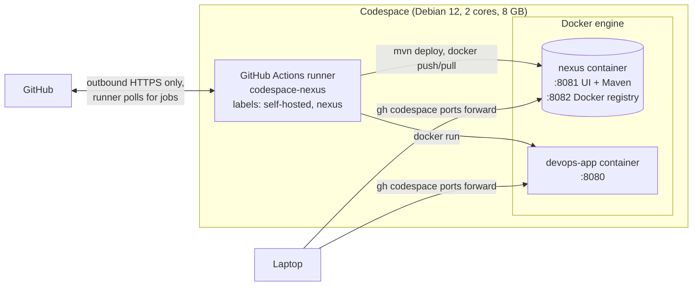

# Setup: the Host (GitHub Codespace)

The procedure for preparing the machine that runs Nexus, the GitHub Actions self-hosted runner, and the deployed app. In this project that machine is a **GitHub Codespace**: a Linux machine in GitHub's cloud, created from this repository and set up by `.devcontainer/devcontainer.json`.

Every step below has been carried out and verified on the project's codespace. Background on why these parts exist: [`ARCHITECTURE.md`](ARCHITECTURE.md). Names and values: section 4 of [`HANDOFF.md`](HANDOFF.md).

Commands are run from a local terminal with the GitHub CLI (`gh`). Opening the codespace in VS Code (browser or desktop) also works where the network allows it, but nothing below depends on it.

---

## What the codespace runs



## Why a codespace

- The project laptop has 7.4 GB RAM. Measured on it, Docker Desktop plus Nexus left 0.73 GB free, too little for a build and the app.
- On the codespace, Nexus uses 1.22 GB and about 5.5 GB stays available.
- Codespaces usage on a personal account is covered by a monthly free allowance (120 core-hours and 15 GB-month of storage on GitHub Free). The 2-core machine uses 2 core-hours per hour of running. Without a payment method on the account, usage beyond the allowance is blocked, not billed.

---

## Step 1: Create the codespace

```bash
gh auth refresh -h github.com -s codespace     # once: lets gh manage codespaces
gh codespace create -R manaymehta/devops-nexus-pipeline -b main \
  -m basicLinux32gb --idle-timeout 30m --display-name devops-nexus-host
```

**What happens:** GitHub builds the container described in `.devcontainer/devcontainer.json`:

| Part | Purpose |
|---|---|
| Image `mcr.microsoft.com/devcontainers/base:1-bookworm` | Plain Debian 12 |
| Feature `java:1` version 21 | JDK 21 for builds and `java -jar` |
| Feature `docker-in-docker:2` | A Docker engine inside the codespace |
| Feature `sshd:1` | Lets `gh codespace ssh` open a terminal in the codespace |
| Local feature `./runner-autostart` | Starts the self-hosted runner whenever the codespace starts (step 5) |
| `hostRequirements` | At least 2 cores and 8 GB |

**Expected result:** `gh codespace list` shows the codespace as `Available`, and

```bash
gh codespace ssh -c <codespace-name> -- 'java -version; docker version; docker compose version'
```

prints Java 21, a Docker server version and a Compose version.

**Known failures:**

| Symptom | Cause |
|---|---|
| No Java or Docker, and the codespace log mentions a recovery container | The dev container build failed. The log is at `/workspaces/.codespaces/.persistedshare/creation.log`. An earlier version of this setup used the `devcontainers/java` image, whose Yarn apt source has a signing key that no longer verifies. That broke the Docker feature's `apt-get update`, which is why the plain Debian image is used. |
| `gh codespace ssh` asks to add the sshd feature | The `sshd:1` feature is missing from `devcontainer.json`. |

---

## Step 2: Start and configure Nexus

Open a terminal in the codespace with `gh codespace ssh -c <codespace-name>`. Then:

```bash
cd /workspaces/devops-nexus-pipeline/infra/nexus
docker compose up -d
cp .env.example .env && nano .env
bash setup-nexus.sh
```

**`.env` values:**

| Variable | Meaning |
|---|---|
| `NEXUS_ADMIN_PASSWORD` | New password for the Nexus `admin` account |
| `NEXUS_CI_PASSWORD` | Password for the `ci` account the pipeline uses. It becomes the GitHub secret `NEXUS_PASSWORD`. |
| `NEXUS_ACCEPT_EULA` | `yes` after reading https://links.sonatype.com/products/nxrm/ce-eula. Nexus Community Edition refuses to store or serve anything (HTTP 403, even for admin) until its licence is accepted. |

- Passwords must not contain `"` or `\`.
- `.env` is git-ignored.
- On the project codespace, both passwords were generated randomly (24 letters and digits).
- To read them: `gh codespace ssh -c <codespace-name> -- cat /workspaces/devops-nexus-pipeline/infra/nexus/.env`.

**Expected output of `setup-nexus.sh`:**
```
==> Nexus is ready
==> Admin password changed
==> EULA accepted
==> Docker Bearer Token Realm activated
==> Anonymous access already disabled
==> Repository docker-hosted created (HTTP connector on port 8082)
==> Role ci-deployer created
==> User ci created
```

A second run prints `already ...` for each item.

**What now exists in Nexus:**

| Item | Purpose |
|---|---|
| `maven-releases` (built in) | Final versions such as `1.0.0`. Re-uploading an existing version is rejected with HTTP 409. |
| `maven-snapshots` (built in) | Work-in-progress `-SNAPSHOT` builds, which can be overwritten |
| `docker-hosted` (created) | Docker images, served as a registry on port 8082 |
| Role `ci-deployer` | Read/write on those three repositories, nothing else |
| User `ci` | The account the pipeline logs in with |

**Checks (all verified):**

| Check | Expected |
|---|---|
| `curl -s -o /dev/null -w '%{http_code}' localhost:8081/service/rest/v1/status` | `200` |
| `docker login localhost:8082 -u ci` | `Login Succeeded` |
| A repository request without credentials | `401` |

---

## Step 3: Store the Nexus credentials as GitHub secrets

Run from the local clone. This needs the repository owner or an admin.

```bash
printf %s ci | gh secret set NEXUS_USER
gh codespace ssh -c <codespace-name> -- \
  'grep "^NEXUS_CI_PASSWORD=" /workspaces/devops-nexus-pipeline/infra/nexus/.env | cut -d= -f2- | tr -d "\r\n"' \
  | tr -d '\r\n' | gh secret set NEXUS_PASSWORD
```

The second command copies the password from the codespace into the secret without printing it.

**Expected result:** `gh secret list` shows `NEXUS_USER` and `NEXUS_PASSWORD`.

---

## Step 4: Install and register the self-hosted runner

**Purpose:** GitHub's cloud runners cannot reach Nexus on the codespace. The runner is GitHub's agent program running inside the codespace. It asks GitHub for jobs over an outbound connection and runs them where Nexus and Docker are reachable.

The runner lives in `/workspaces/actions-runner`, outside the repository folder. `/workspaces` survives codespace stops and rebuilds.

```bash
# in the codespace: download and verify (version from https://github.com/actions/runner/releases)
mkdir -p /workspaces/actions-runner && cd /workspaces/actions-runner
curl -sSLO https://github.com/actions/runner/releases/download/v2.338.0/actions-runner-linux-x64-2.338.0.tar.gz
sha256sum actions-runner-linux-x64-2.338.0.tar.gz   # compare with the SHA on the release page
tar xzf actions-runner-linux-x64-2.338.0.tar.gz && rm actions-runner-linux-x64-2.338.0.tar.gz
```

```bash
# locally: get a registration token (valid one hour, owner/admin only) and register
TOKEN=$(gh api -X POST repos/manaymehta/devops-nexus-pipeline/actions/runners/registration-token --jq .token)
gh codespace ssh -c <codespace-name> -- "cd /workspaces/actions-runner && ./config.sh --unattended \
  --url https://github.com/manaymehta/devops-nexus-pipeline --token $TOKEN \
  --name codespace-nexus --labels nexus --work _work --replace"
```

**Expected result:** after step 5 starts it, `gh api repos/manaymehta/devops-nexus-pipeline/actions/runners` lists `codespace-nexus` as `online`, with labels `self-hosted, X64, nexus, Linux`.

---

## Step 5: Runner start on every codespace start

A codespace stops after 30 idle minutes, and the runner process stops with it. Two mechanisms bring everything back on the next start:

| What | How it restarts |
|---|---|
| Nexus | Its container has `restart: unless-stopped`, so Docker starts it again once the Docker engine is up |
| Runner | The local feature `.devcontainer/runner-autostart` installs a hook into the container's entrypoint. The hook runs `.devcontainer/start-runner.sh` as the `vscode` user. |

`start-runner.sh` does nothing if the runner is not registered or already running. It can also be run by hand:

```bash
bash /workspaces/devops-nexus-pipeline/.devcontainer/start-runner.sh
```

**Why not `postStartCommand`:** a runner started from `postStartCommand` was stopped within milliseconds of that command finishing, as the codespace creation log showed. Processes started from the container entrypoint, like the Docker engine and the SSH server, keep running.

**Verified:** after a rebuild and after a stop/start, the runner came back online with no manual step. Nexus kept all its configuration, so its data volume survived the rebuild.

**Timing after a start:** the Docker engine, and with it Nexus, take a few minutes to come up after the codespace starts. The runner can come online before Nexus answers.

---

## Everyday use

| Purpose | Command (locally) |
|---|---|
| Start the codespace | `gh codespace ssh -c <name> -- true` (any ssh starts it), or open it from github.com/codespaces |
| Stop it (saves free hours) | `gh codespace stop -c <name>` |
| Terminal in the codespace | `gh codespace ssh -c <name>` |
| Open the app and Nexus on the laptop | `gh codespace ports forward 8080:8080 8081:8081 -c <name>`, then http://localhost:8080/api/version and http://localhost:8081 |
| Runner status | `gh api repos/manaymehta/devops-nexus-pipeline/actions/runners --jq '.runners[] \| "\(.name) \(.status)"'` |
| Nexus passwords | `gh codespace ssh -c <name> -- cat /workspaces/devops-nexus-pipeline/infra/nexus/.env` |

| Purpose | Command (in the codespace) |
|---|---|
| Running app version | `curl localhost:8080/api/version` |
| Nexus logs | `docker logs -f nexus` |
| Runner log | `tail -f /workspaces/actions-runner/runner.log` |
| Memory use | `docker stats --no-stream; free -m` |
| Delete Nexus and **all** stored artifacts | `cd /workspaces/devops-nexus-pipeline/infra/nexus && docker compose down -v` |

---

## On a local machine instead

The same files work on any machine with Docker and about 3 GB of free RAM:
- Start Nexus with `docker compose up -d` in `infra/nexus`, then run `setup-nexus.sh`, in Git Bash on Windows.
- Register a runner from repository → Settings → Actions → Runners → New self-hosted runner, adding the label `nexus`.

This was not used for the project, because the laptop has too little memory. On Windows, the runner runs `shell: bash` steps with the first `bash` on `PATH`. That should be Git Bash, not WSL's `System32\bash.exe`.
